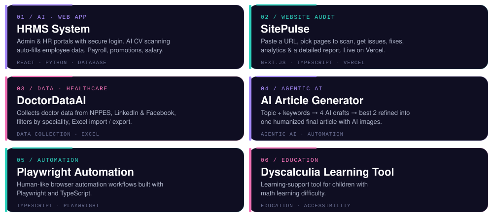

 

---

## 👩‍💻 About Me

 

---

## 🛠️ Tech Stack

 

---

## 🚀 Featured Projects

 

---

## 🧭 My Journey

---

## 🐍 Contribution Snake

<a href="https://github.com/Platane/snk">
<picture>
  <source media="(prefers-color-scheme: dark)" srcset="https://raw.githubusercontent.com/emanfatima72/emanfatima72/output/github-snake-dark.svg" />
  
</picture>
</a>

---

## 🎨 Beyond Code

- 🩸 Member — **Jahad for Zero Thalassemia (JZT)**, creating awareness content & community outreach
- 🤝 Ambassador (2023–24) — **Muwakhat Foundation**, Lahore
- 🎨 Former **Design Lead** — led design projects & quality reviews
- 📝 I write at **[plaintec.blogspot.com](https://plaintec.blogspot.com/)**

---

*"Make it work, make it right, make it beautiful."* ✨

